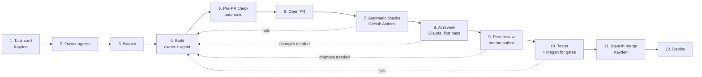
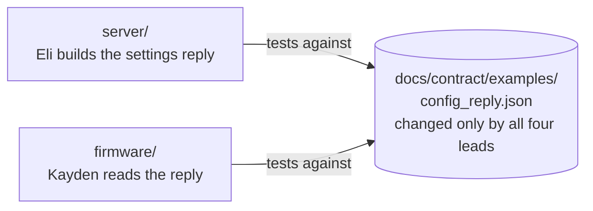
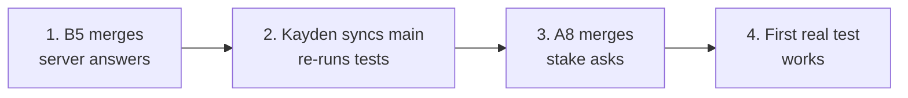
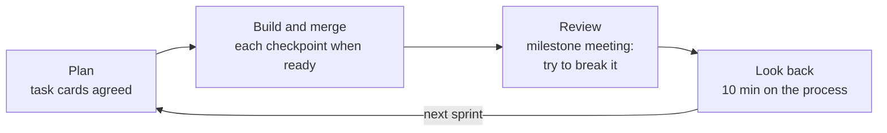
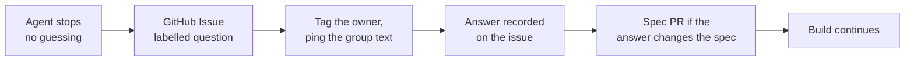

# Sprout Orchestration Plan

How the four of us and our AI coding agents build Sprout without overwriting each other's work.

- **Written:** 16 Nov 2026, from the team's planning sessions of 10–13 Nov.
- **Applies to:** every checkpoint in section 3 of the [Sprout Master Specification v3](../Sprout%20Master%20Specification%20v3.md).
- **Relationship to the spec:** the spec says *what* gets built. This document says *how* we work together to build it. Where they disagree, the spec wins until a spec pull request changes it. Section 11 lists the places where this plan needs a spec update.

## Contents

1. [Team and tracks](#1-team-and-tracks)
2. [Phases](#2-phases)
3. [The life of one checkpoint](#3-the-life-of-one-checkpoint)
4. [Who owns which files](#4-who-owns-which-files)
5. [When a feature needs two people](#5-when-a-feature-needs-two-people)
6. [Where you see your work: mock, live and practice](#6-where-you-see-your-work-mock-live-and-practice)
7. [The sprint rhythm](#7-the-sprint-rhythm)
8. [Rules for clashes, questions and spec changes](#8-rules-for-clashes-questions-and-spec-changes)
9. [Guardrails against vibe coding](#9-guardrails-against-vibe-coding)
10. [Tools and outside services](#10-tools-and-outside-services)
11. [Decision log](#11-decision-log)
12. [Open items](#12-open-items)
13. [Phase 0 setup checklist](#13-phase-0-setup-checklist)

---

## 1. Team and tracks

| Person | Track | Also does |
| --- | --- | --- |
| Kayden | Device: firmware, wiring, enclosure, hardware gates | Repo owner; writes task cards; clicks Merge; B14 (optional diagnosis) |
| Eli | Backend and AI: database, API, simulator, model, alerts, server, backups | Owns the practice server |
| Ca'Marion | Frontend: dashboard, charts, claim and setup flow | Tests Megan's frontend checkpoints |
| Megan | Design and QA: visual system, species research, test log, gate witnessing | Builds C9, C10, C13, C14, C15 and B7 |

**Core rule: if it's not in the repo, it doesn't exist.** Code, test results, task cards and decisions all live in this repository. AI sessions don't remember anything between conversations, so anything left only in a chat is lost.

---

## 2. Phases

Each phase groups milestones from spec section 4.1. Phase 0 is the only new piece: it sets up the repo so the rest can run smoothly.

| Phase | Ends | Goal |
| --- | --- | --- |
| **0. Foundation** | As soon as possible, before the next checkpoints merge | Folder skeleton, agent rules file, automatic checks, templates, ownership file, branch protection. No feature code |
| **1. Contract and walking skeleton** | Fri 4 Dec | B1, B2, C1, then one rough end-to-end path: stake → database → dashboard |
| **2. Bench to plant** | Fri 18 Dec | Gates G2–G23, the G20 soil test, claim and setup, plant goes in |
| **3. Learning** | Fri 29 Jan | B11, C6, B12, simulator recovery (G24) |
| **4. Product features** | Fri 19 Mar | Accounts, devices, mobile, model evaluation, optional diagnosis |
| **5. Hardening** | Fri 23 Apr | Second unit, history view, polish, demo-day fallback rehearsal |
| **6. Freeze and demo** | Fri 14 May | Bug fixes only after 30 Apr; report, presentation, demo |

---

## 3. The life of one checkpoint

Every checkpoint (B3, C4, A8 and so on) goes through the same twelve steps. Steps marked *automatic* run without a person. Any check that fails sends the work back to step 4, on the same branch.

| # | Step | Who | What happens |
| --- | --- | --- | --- |
| 1 | Task card | Kayden | Saved as `tasks/<ID>.md` a week before the checkpoint's due week. Holds the "Done when", the spec sections it depends on (copied in, not linked), the exact files the agent may create or change, the test or gate that proves it, and the standing rules |
| 2 | Owner agrees | Owner | The owner reads the card before their agent touches code and asks about anything unclear. If you can't explain the card, your agent can't follow it |
| 3 | Branch | Owner | Named after the checkpoint, for example `b3-ingest`. At most two open branches per person, and never two that change the same files |
| 4 | Build | Owner + agent | Give the card to the agent. **Every work session starts by pulling the latest `main` into the branch.** If the spec doesn't say something, stop and use the question flow (section 8.2) |
| 5 | Pre-PR check | Owner's agent (automatic) | The agent pulls in `main` one last time, runs every test, and confirms only the card's files changed |
| 6 | Open PR | Owner | Title starts with the checkpoint ID. The PR template asks what changed, why, and how it was tested, **in the owner's own words**, plus the test output |
| 7 | Automatic checks | GitHub Actions | Server tests against a fresh MySQL 8.4, web type check and tests, firmware logic tests. Also fails the PR for files outside the card, any use of SQLite or Replit's database, or an unapproved contract change |
| 8 | AI review | Claude, run by Kayden | Checks the PR against its task card and spec sections 8 and 9, and posts a plain-English summary of anything wrong. It's a comment, not an approval |
| 9 | Peer review | Anyone except the author | Reads the AI summary and the change, then approves. GitHub also requires the owner of any folder the PR touches |
| 10 | Tester | Tester from spec 3.8 | Checks it works. Megan witnesses any gate it touches. Nobody signs off their own work |
| 11 | Squash merge | Kayden | All the PR's commits become one commit on `main`, and the branch is deleted. If an approved PR with passing checks waits 48 hours, its tester may merge it |
| 12 | Deploy | Deploy script | The server pulls `main`, runs migrations, rebuilds the dashboard and restarts (spec 15.4). From 18 Dec, the practice server also runs each merged version |

**Branch length.** There's no age limit on a branch. What keeps conflicts small is syncing often: pull `main` into your branch at the start of every work session, and again just before opening the PR.

---

## 4. Who owns which files

Git only produces a conflict when two people change the same file, so every folder has one owner. This table becomes the repo's `CODEOWNERS` file, which makes GitHub ask the right person to review automatically.

| Folder or file | Owner | What lives there |
| --- | --- | --- |
| `firmware/` | Kayden | `src/logic/` holds everything that doesn't touch hardware (watering rule, failsafes, calibration maths, record packing, status), tested on a laptop. Separate modules for sensors, buffer, network, LED and power. `experiments/` holds the A2–A3 bench programs |
| `server/` | Eli | API, database code, simulator, model, alerts, scheduled jobs |
| `server/` species integration | Megan | B7, the Perenual lookups. Exact folder fixed in Phase 0 |
| `server/` diagnosis | Kayden | B14, optional and first to cut |
| `server/` migrations | **Eli only** | B1 creates every table in spec section 9. Only Eli writes later migrations |
| `tools/` | Eli | B17 provisioning tool. Kayden reviews, because it writes to the stake |
| `web/src/screens/<screen>/` | Per screen | One folder per screen. **Ca'Marion:** Home, Plant detail, Add device, Plant setup, Sign up and Log in, Account, Diagnosis history. **Megan:** Devices, Help, History |
| `web/src/` route list | Shared, locked | C1 registers every screen with a placeholder up front, so nobody edits it to add a screen later |
| `web/src/api/types.ts` | Shared | The shape of every API reply. Both frontend devs review. A change to a contract field also needs all four leads |
| `web/src/components/` | Shared | Pieces every screen uses. Both frontend devs review |
| `docs/contract/examples/` | All four leads | The example JSON from spec section 8. Everyone builds against it; nobody edits it alone |
| The spec | Tiered (section 8.3) | The repo copy is the master |
| `tasks/` | Kayden | One task card per checkpoint |
| `.github/` and the agent rules file | Kayden | Automatic checks, PR template, `CODEOWNERS`, and the rules every agent reads. Changing a rule needs all four leads |

**Three checkpoints cross other people's screens:**

- **C9 (Recalibrate and Reset learning)** is Megan's but sits on Ca'Marion's Plant detail screen. It gets its own sub-folder inside that screen's folder.
- **C10 (Mobile)** and **C14 (Polish)** touch every screen. They go in as one small PR per screen, only on screens nobody else has an open branch for.

---

## 5. When a feature needs two people

Some checkpoints come in pairs. Both people build at the same time, in their own folders, against one shared example file that neither of them edits.

Example: **B5** (Eli: the server sends settings to the stake) and **A8** (Kayden: the stake obeys them).

1. **Both build in parallel.** Eli's test: "the settings reply for a test plant has exactly the fields and types in `config_reply.json`." Kayden's laptop test: "feeding `config_reply.json` to the stake's reader produces threshold 30.0, the right sync window, and so on."
2. **The side that answers merges first.**
   - Server before device: B5 before A8.
   - Backend before frontend: B6 before C2, B8 before C4, B9 before C7.
3. **The second side syncs `main`, re-runs its tests, and merges.**
4. **If the example file looks wrong,** both people stop, open a `question` issue, and all four leads approve the change.

Nothing gets overwritten because the two people never edit the same file. The example file is like an agreed order slip: both sides practise against it, so they fit together on the first real try. Each cross-track task card names its partner checkpoint and the merge order.

---

## 6. Where you see your work: mock, live and practice

You can always see your screens while you code and after you merge. The only thing that changes over time is **where it's safe to press buttons that change data, on code that hasn't merged yet.**

### The three places a dashboard can get data

| Place | What it is | Analogy |
| --- | --- | --- |
| **Mock data** | A file of frozen fake numbers inside the dashboard code. Buttons do nothing real | Reading the script around a table |
| **Practice server** | A second copy of the server on the same Oracle machine, with its own database of simulated plants and a private address such as `test.sprout.<domain>`. No stake talks to it | Dress rehearsal on the real stage, no audience |
| **Live server** | The public website and the real stake and plant | Opening night |

### What each can check

| Check | Mock | Practice | Live |
| --- | --- | --- | --- |
| Layout, colours, wording | Yes | Yes | Yes |
| The chart draws | Made-up numbers | Simulator data | Real data |
| Loading, error and empty states | If faked by hand | Yes | Yes |
| Water now: queued, delivered, refused | No | Yes | Yes, on the real plant |
| Claiming a stake | No | Yes | Yes |
| Recalibrate, Reset learning | No | Yes | Yes, changes the real plant's watering |
| Alerts appearing and clearing | No | Yes | Yes |
| Logging in (from March) | No | Yes | Yes |

### The decision: mock and live until 18 Dec, practice server from 18 Dec

| Period | While coding | Pressing buttons on unmerged code | After merging |
| --- | --- | --- | --- |
| Now – 19 Nov | Mock data in the Replit preview | Not possible yet | Not possible yet |
| 20 Nov – 17 Dec | Mock data | Live server, because there's no plant yet. **No clicks during the G20 soil test, 7–10 Dec** | Real website, bench-test data |
| From 18 Dec | Mock data | **Practice server only** | Real website, the real basil |

- Looking at the live website like a normal user is always fine. The rule is only that in-progress code never presses buttons on the live server once the plant is in.
- Mock data stays in use all year for the automatic tests, which need fixed, predictable data.
- The practice server is Eli's. The simulator (B2) fills it; if someone breaks the fake plants, rerun the simulator.
- Test rows created on the live server before 18 Dec are cleared before the plant goes in.

### Who this affects

| Person | Effect |
| --- | --- |
| Ca'Marion and Megan | Point their in-progress dashboard at the practice server from 18 Dec and try every button safely |
| Megan as tester, Ca'Marion testing Megan's work | Can test a PR before it merges |
| Eli | Sets up and maintains the practice server |
| Kayden as reviewer | Can click through a PR's screens before approving |
| Kayden as device lead | No change: the stake only ever talks to the live server. The practice server keeps everyone else's testing away from the plant |

---

## 7. The sprint rhythm

A sprint runs from one milestone to the next. **Code merges as each checkpoint is ready, inside the sprint, not in one pile at the end.** Merging everything at the end causes the worst conflicts, and nobody can tell whose change broke the site.

1. **Plan:** task cards for the sprint's checkpoints are written and agreed.
2. **Build and merge:** each checkpoint follows section 3 and merges when ready.
3. **Review:** the milestone meeting. Everyone tries the whole system end to end and tries to break it. Bugs become GitHub Issues.
4. **Look back:** ten minutes on *how* we worked. Did agents wander? Did reviews take too long? Fix the rules for the next sprint.
5. **Unfinished work carries into the next sprint.** A sprint is never redone.

**Sprint boundaries** are the milestone dates in spec 4.1: 13 Nov, 20 Nov, 4 Dec, 11 Dec, 18 Dec, 8 Jan, 29 Jan, 19 Mar, 16 Apr, 23 Apr, 30 Apr, 7 May. The gap from 29 Jan to 19 Mar is long enough to split into two-week sprints.

Sprint length is set by school days, reviews and bench testing, not by how fast an agent types.

---

## 8. Rules for clashes, questions and spec changes

### 8.1 Two people need the same shared file

- The person with the smaller change updates their branch and re-checks.
- If both changes are the same size, whoever merged most recently waits.
- Database migrations: Eli only.
- Screen routes: set once in C1, never added later.

### 8.2 When the spec doesn't say: the question flow

- If a PR is already open, the question can be a PR comment instead of an issue.
- The issue names the checkpoint and the spec section.
- The owner of an open question is listed in spec section 17.2.

### 8.3 Spec changes

The repo copy of the spec is the master. Any other copy is read-only or deleted. Every change goes through a pull request:

| Kind of change | Who approves |
| --- | --- |
| Typos and wording | Anyone except the author |
| Inside one track (for example a firmware detail) | That track's lead |
| Sections 8, 9 or 13.2 (contract, database, response shapes) | All four leads |

New decisions are logged in spec section 1 as DEC-34, DEC-35 and onward.

### 8.4 Communication

- **Group text:** quick pings only ("I opened a question on B3").
- **GitHub Issues and PRs:** anything that matters (questions, answers, decisions, bugs), so agents and future sessions can find it.

---

## 9. Guardrails against vibe coding

An agent can ignore a rule that's only a request. Wherever possible, a robot or a GitHub setting enforces the rule instead.

| Rule | Enforced by |
| --- | --- |
| Every branch starts from an agreed task card | Review: no card, no review |
| Change only the files the card lists | Automatic check fails the PR |
| MySQL 8.4 only; never SQLite or Replit's database | Automatic check fails the PR |
| Never rename, remove or retype a contract field | Contract example tests, plus all-leads approval on the example files |
| Nobody pushes straight to `main` | GitHub branch protection |
| Nobody approves their own work | GitHub, plus `CODEOWNERS` |
| All tests pass before merging | GitHub requires passing checks |
| Explain your PR in your own words | Peer review |
| Code is never copied by hand out of a chat window | Team rule |
| If the spec doesn't say, stop and ask | Agent rules file, plus the question flow |
| No secrets in the repo (the repo is public) | GitHub secret scanning with push protection |

**Replit Agent:** earlier tests showed it works reliably when the rules file and the automatic checks spell out exactly what it can and can't do. Every review still opens the PR's **Files changed** tab.

---

## 10. Tools and outside services

Almost everything is free. The only new cost is a domain name, about $10 a year.

### 10.1 Outside services

| Service | What it does for Sprout | Who deals with it |
| --- | --- | --- |
| GitHub | Code, PRs, Issues, Actions (the test robot), nightly backups in a second private repo | Everyone; Kayden owns it |
| Oracle Cloud (Always Free) | The machine that runs the live server, database, website and practice server | Eli |
| Cloudflare Tunnel (free) | Gives the server a secure public address without opening it to the internet | Eli |
| A domain name (~$10/year) | The website's address, such as `sprout.<domain>`. Not bought yet (Q19) | Eli |
| Perenual | Plant names, photos, toxicity and care text for the species | Megan (B7) |
| Google AI Studio, Gemini Flash (free tier) | Looks at leaf photos for the optional diagnosis | Kayden (B14) |
| Time servers (`pool.ntp.org`, `time.google.com`) | The stake sets its clock from these at every sync | Kayden |

### 10.2 Server software (Eli)

| Tool | Job |
| --- | --- |
| Ubuntu 24.04 | Operating system on the Oracle machine |
| Docker | Runs MySQL identically on the server and every laptop |
| MySQL 8.4 LTS | The database |
| Python 3.12+ | The server's language |
| FastAPI + uvicorn | Turn Python code into a web server |
| SQLAlchemy 2 | Lets Python talk to MySQL |
| Alembic | Creates and changes tables in numbered steps (migrations) |
| PyMySQL + cryptography | Connect Python to MySQL 8.4 |
| Pydantic v2 | Checks every message has the right fields and types |
| argon2-cffi | Scrambles passwords so they're never stored readable |
| numpy | Maths for the learning model |
| APScheduler 3.x | Timed jobs: weekly model fit, alerts, nightly backup |
| Pillow | Leaf photo thumbnails |
| pytest, ruff | Tests and tidy-code checks |
| uv | Installs and locks exact library versions |
| systemd | Restarts the server automatically if it crashes |

### 10.3 Dashboard software (Ca'Marion and Megan)

| Tool | Job |
| --- | --- |
| React 18 | Builds screens from reusable pieces |
| TypeScript | Catches wrong field names before the code runs |
| Vite | Live preview while coding; builds the final website |
| React Router | Switches between screens |
| TanStack Query | Fetches data from the server and keeps it fresh |
| Recharts | Charts, including the 14-day sawtooth |
| vitest | Dashboard tests |
| Node.js (current LTS) | Runs Vite and the build |

### 10.4 Firmware software (Kayden)

| Tool | Job |
| --- | --- |
| PlatformIO | Builds and flashes the stake; runs logic tests on a laptop (`pio test -e native`) |
| Arduino-ESP32 core 3.x via pioarduino | Base software for the Seeed XIAO ESP32-C3 |
| BH1750 library | Reads the light sensor |
| ArduinoJson | Builds the upload and reads the settings reply |
| WiFi, WiFiMulti, WiFiClientSecure, HTTPClient | WiFi and secure uploads |
| Preferences, LittleFS | Settings and the offline buffer on the chip |
| ESP-IDF calls | Deep sleep, button wake, clock |

### 10.5 Team tools

| Tool | Who | Used for |
| --- | --- | --- |
| Claude Code | Kayden | Task cards, building, AI review |
| Replit Core (~$20 credits each) | Eli, Ca'Marion, Megan | Building checkpoints with Replit Agent |
| Mistral, Google AI Studio | Everyone | Questions and small fixes, to save Replit credits |
| Shared test log sheet (D2) | Megan | One row per gate with measured values |
| Group text | Everyone | Quick pings |

### 10.6 Secrets

The repo is public, and bots scan public repos for keys within minutes. These are **never** committed:

- the Gemini key and the Perenual key
- device keys and claim codes
- database passwords and the server's `SECRET_KEY`

They go in the server's private settings file (`/etc/sprout/sprout.env`, spec 5.2), or in GitHub's encrypted Actions secrets for the test robot.

---

## 11. Decision log

| # | Topic | Decision | Changes the spec? |
| --- | --- | --- | --- |
| 1 | Git experience | Everyone has used branches and PRs | No |
| 2 | Repo visibility | Public, so `main` can be protected for free. Kayden is the owner | No |
| 3 | Collaborators | All four added | No |
| 4 | Open branches | At most two per person, never touching the same files | No |
| 5 | Branch length | No age limit; pull in `main` every session; sync and test before the PR | No |
| 6 | Task cards | Kayden writes them; the owner agrees before building | No |
| 7 | Questions | GitHub Issue labelled `question`, owner tagged, group-text ping; spec PR if the answer changes the spec | No |
| 8 | Migrations | B1 creates every table; only Eli writes later migrations | No |
| 9 | Routes | C1 registers every screen route up front | No |
| 10 | Shared-file clashes | Smaller change updates; same size → most recent merger waits | No |
| 11 | Environments | Mock and live until 18 Dec; practice server from 18 Dec | **Yes:** section 5 (practice server; live use before 18 Dec, which 5.2 currently forbids) |
| 12 | Handoff | Kayden writes a handoff doc for the 19 Nov walk-throughs | No |
| 13 | Tests | GitHub Actions on every PR, with its own MySQL 8.4 | **Yes:** section 3.9 (Kayden no longer runs backend tests by hand) |
| 14 | Merging | Kayden squash-merges; the tester may after 48 hours | No |
| 15 | Merge style | Squash merge only; branches deleted after merging | No |
| 16 | Cross-track work | Shared example files; the side that answers merges first | No |
| 17 | Spec master | The repo copy is the master; tiered approval | No |
| 18 | Reviews | AI first pass, then a peer approves, starting now | **Yes:** section 3.9 (says to decide on peer review in January) |
| 19 | Replit | Reliable with an exact rules file and automatic checks | No |
| — | Communication | Group text for pings; GitHub Issues for anything important | No |
| — | Sprints | Milestone-to-milestone sprints, merging as you go | No (pending the teacher's answer, section 12) |

---

## 12. Open items

| Item | Owner | Needed by |
| --- | --- | --- |
| Confirm the practice server can be ready by Fri 18 Dec, during the busy December weeks | Eli | Before the 4 Dec milestone |
| Ask the teacher whether merging only at sprint end is required. If so, use a shared sprint branch that merges into `main` at sprint end, instead of everyone merging alone | Kayden | Next class |
| Spec PRs for decisions 11, 13 and 18 | Kayden | This sprint |
| Spec fix: section 10.9 says to install the Anthropic SDK for diagnosis, but section 12.5 and Q11 chose Gemini on 4 Nov | Kayden | Before B14 starts |
| Spec fix: section 1A, row E-5 still says "Pi (DEC-01)"; the server is now Oracle | Anyone | This sprint |
| Freeze section 13.2 (response shapes) together with section 8 | All four leads | Next team meeting |
| Settle what happens when `sent_time` is more than 5 minutes off (8.3 sets the range; 10.1 never says what to do). Suggested: treat it as unknown and accept the batch | All four leads | Before B3 merges |
| Clear live-server test rows before the plant goes in | Eli | Fri 18 Dec |
| Check Perenual's free limits | Megan | When B7 starts |
| Before the repo goes public: check the deleted `.docx` in the git history, and confirm everyone (including Mr. Benrud) is fine with their names being public | Kayden | Before switching to public |

---

## 13. Phase 0 setup checklist

Each item is its own small PR, following section 3.

- [ ] Make the repo public (after the checks in section 12)
- [ ] Turn on branch protection for `main`: require a PR, one approval, code-owner review and passing checks
- [ ] Repo settings: allow squash merge only; automatically delete branches after merging
- [ ] Turn on secret scanning and push protection
- [ ] Folder skeleton: `firmware/`, `server/`, `web/`, `tools/`, `docs/`, `tasks/`, including `firmware/src/logic/`, `firmware/experiments/` and one folder per screen under `web/src/screens/`
- [ ] Agent rules file at the repo root (the four rules from spec section 0 and the standing rules from 3.9), plus short pointer files for Claude Code and Replit
- [ ] `.gitignore`, including Replit's own setup files (`.replit`, `replit.nix`)
- [ ] `CODEOWNERS` from section 4
- [ ] Task card template (`tasks/TEMPLATE.md`) and PR template
- [ ] `docs/contract/examples/`: one JSON file per message in spec section 8
- [ ] GitHub Actions: server tests with MySQL 8.4, web type check and tests, firmware logic tests, allowed-files check, no-SQLite check, contract-lock check
- [ ] `question` label for GitHub Issues
- [ ] Pinned group-text message with links to the repo, open questions and the test log
